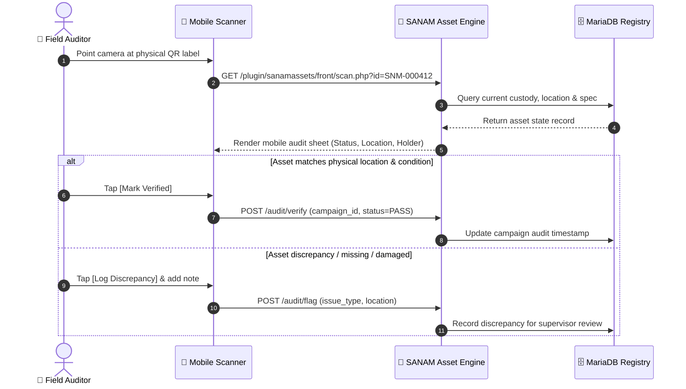

<div align="center">


### Next-Generation IT Asset Management & Mobile Physical Audit System

[](https://www.php.net/)
[](https://mariadb.org/)
[](LICENSE)
[](#-installation--quick-start)
[](#-mobile-field-operations)

---

[**Overview**](#-overview) • [**Core Pillars**](#-core-pillars-bento-grid) • [**Visual Tour**](#-visual-walkthrough) • [**Architecture**](#-audit-workflow-architecture) • [**Feature Matrix**](#-sanam-vs-generic-systems) • [**Quick Start**](#-installation--quick-start) • [**Tooling**](#-automation-tooling)

</div>

---

## 🌟 Overview

**SANAM** is an enterprise-grade IT Asset Management and ITIL Service Desk platform engineered for complete physical lifecycle accountability. Designed from the ground up to solve real-world field auditing challenges, SANAM couples an immutable asset registry with print-ready QR tagging, responsive mobile audit verification, employee custody workflows, and corporate telecom line management.

```
                   PHYSICAL ASSET ➔ QR SCAN ➔ INSTANT AUDIT RECONCILIATION
                                           │
  ┌────────────────────────────────────────┴────────────────────────────────────────┐
  ▼                                        ▼                                        ▼
[Permanent Asset ID]             [Mobile Auditor Mode]                    [Custody & Handover]
SNM-000001 (Never reused)       No app required; browser QR              Exit clearance & signing
```

---

## 🍱 Core Pillars (Bento Grid)

<table align="center" width="100%" border="0" cellSpacing="8" cellPadding="0">
  <tr>
    <td width="55%" valign="top" style="padding: 16px; border: 1px solid #30363d; border-radius: 10px;">
      <h3>📱 Mobile QR Audit Engine</h3>
      <p>A native, lightweight mobile-friendly interface for in-the-field asset verification. Zero app installation required—simply scan any asset tag directly from any smartphone browser.</p>
      <ul>
        <li><b>Single-Tap Verification:</b> Match physical state against registry records instantly.</li>
        <li><b>Discrepancy Reporting:</b> Flag missing, relocated, or damaged devices in real time.</li>
        <li><b>Rapid Registration:</b> Draft new hardware right from the receiving dock.</li>
      </ul>
    </td>
    <td width="45%" valign="top" style="padding: 16px; border: 1px solid #30363d; border-radius: 10px;">
      <h3>🔒 Immutable Asset Identity</h3>
      <p>Guaranteed uniqueness across your entire enterprise infrastructure.</p>
      <ul>
        <li><b>Sequential IDs:</b> <code>SNM-000001</code> issued permanently.</li>
        <li><b>Anti-Collision:</b> Strict validation halts duplicate serials or reused IDs.</li>
        <li><b>Tamper-Proof:</b> History preserved across entity transfers and reassignment.</li>
      </ul>
    </td>
  </tr>
  <tr>
    <td width="45%" valign="top" style="padding: 16px; border: 1px solid #30363d; border-radius: 10px;">
      <h3>🏢 Multi-Entity & Telecom Tracking</h3>
      <p>Manage corporate subsidiaries, departmental locations, and cellular lines in a unified pane.</p>
      <ul>
        <li><b>SIM & Number Management:</b> Track corporate lines, carriers, and hardware pairings.</li>
        <li><b>Employee Handover:</b> Formal issue, return, and exit clearance sign-offs.</li>
        <li><b>Location Mapping:</b> Yard, office, and desk-level precision.</li>
      </ul>
    </td>
    <td width="55%" valign="top" style="padding: 16px; border: 1px solid #30363d; border-radius: 10px;">
      <h3>⚡ Frictionless Local Deployment</h3>
      <p>Instant provisioning with zero manual SQL configuration or dependency headaches.</p>
      <ul>
        <li><b>PowerShell Scripts:</b> Automated schema installation and service launchers.</li>
        <li><b>Isolated Workspaces:</b> Separate production, test, and sample demo environments.</li>
        <li><b>Portable Architecture:</b> Self-contained server binding on demand.</li>
      </ul>
    </td>
  </tr>
</table>

---

## 📸 Visual Walkthrough

### 🖥️ Executive Asset Dashboard
Real-time breakdown of asset health, warranty deadlines, verification statuses, and upcoming audits:
<div align="center">
  
</div>

<br/>

### 📱 Mobile Field Operations

| 1. Instant Phone QR Scan | 2. Mobile Auditor Registry | 3. Custody & Handover |
|:---:|:---:|:---:|
|  |  |  |
| *Real-time QR barcode decode & status lookup* | *Direct auditor registration for new arrivals* | *Asset assignment, transfer & return clearance* |

<br/>

### 🗂️ Audit Campaigns & Label Generation

| Verification Audit Campaigns | High-Density QR Asset Labels |
|:---:|:---:|
|  |  |
| *Structured campaigns with area tracking & progress* | *Print-ready vector labels with permanent SNM ID* |

---

## 🔄 Audit Workflow Architecture



---

## ⚖️ SANAM vs Generic Systems

| Feature | Generic Asset Trackers | SANAM Platform |
|---|:---:|:---:|
| **Identity Guarantee** | Mutable names / loose serials | 🔒 **Permanent, immutable sequential IDs (`SNM-xxxxxx`)** |
| **Field Audits** | Paper sheets or external apps | 📱 **Native mobile web scanner with discrepancy flagging** |
| **Duplicate Prevention** | Rarely enforced | 🛡️ **Zero-tolerance serial collision checks on commit** |
| **Custody Lifecycle** | Simple "user" field | 📋 **Full issue, return, transfer, and exit sign-off trail** |
| **Telecom Integration** | Disconnected spreadsheets | 📞 **Native SIM, carrier, and corporate line tracking** |
| **Setup Overhead** | Complex server stack | ⚡ **Single-command PowerShell automation** |

---

## 🚀 Installation & Quick Start

### 📋 Prerequisites
- **Windows 10 / 11 / Server** (or Linux with PHP CLI)
- **PHP 8.3+** with extensions: `curl`, `gd`, `intl`, `mysqli`, `openssl`, `mbstring`
- **MariaDB 10.6+ / 11.x** running locally on port `3306`

### 1️⃣ Clone the Repository
```powershell
git clone https://github.com/it1buildhub-hue/SANAM.git
cd SANAM
```

### 2️⃣ Automated Database & Configuration Setup
Run the automated installation script. It builds the schema, configures paths, and seeds default parameters:

```powershell
powershell -NoProfile -ExecutionPolicy Bypass -File scripts\install.ps1
```

> **Need a Sandbox?** Build an isolated demonstration instance with sample data on port `8083`:
> ```powershell
> powershell -NoProfile -ExecutionPolicy Bypass -File scripts\install.ps1 -Demo
> ```

### 3️⃣ Start the SANAM Service
Launch the local application server:

```powershell
powershell -NoProfile -ExecutionPolicy Bypass -File scripts\start.ps1
```

Open your browser to:
👉 **`http://127.0.0.1:8081`** *(or `http://127.0.0.1:8083` for Demo)*

---

## 🛠️ Automation Tooling

The [`plugin/sanamassets/tools/`](file:///C:/Users/buildhub/IT-assets/plugin/sanamassets/tools/) directory provides robust administrative utilities:

| Tool | Purpose | Command |
|---|---|---|
| `seed_sanam.php` | Idempotent baseline seeder: asset types, states, roles | `php tools/seed_sanam.php` |
| `seed_fields.php` | Extra telemetry fields: IMEI2, PoE, management IP | `php tools/seed_fields.php` |
| `seed_demo.php` | Sample corporate hardware, phone lines, and custody records | `php tools/seed_demo.php` |
| `backup_restore_test.ps1` | Automated backup dump, restore rehearsal, and table checksum verification | `powershell -File tools/backup_restore_test.ps1` |

<details>
<summary><b>🔍 Directory Tree Details</b></summary>

```
SANAM/
├── core/                        # SANAM 11 application core
│   ├── ajax/                    # Asynchronous endpoints
│   ├── bin/                     # CLI console utilities
│   ├── inc/                     # Core system definitions
│   ├── src/Sanam/               # SANAM core namespace & classes
│   └── templates/               # Twig layout templates
├── plugin/
│   └── sanamassets/             # SANAM Assets Custom Extension
│       ├── front/               # Scan, campaign, label, custody interfaces
│       ├── src/                 # AssetId, Campaign, Custody, Label, Scan engines
│       ├── theme/               # SCSS stylesheet & high-resolution brand assets
│       └── tools/               # Seeding, backup rehearsals & provisioning
├── scripts/
│   ├── install.ps1              # Deployment & database installer
│   └── start.ps1                # Background service launcher
└── docs/
    └── images/                  # UI screenshots and visual documentation
```
</details>

---

## 📄 License & Attribution

SANAM is released under the **GNU General Public License (GPLv3)**. See [`LICENSE`](LICENSE) for terms.
Built with dedication for streamlined IT infrastructure operations.
