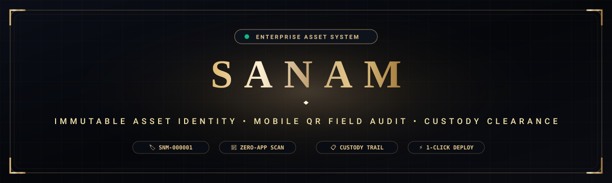
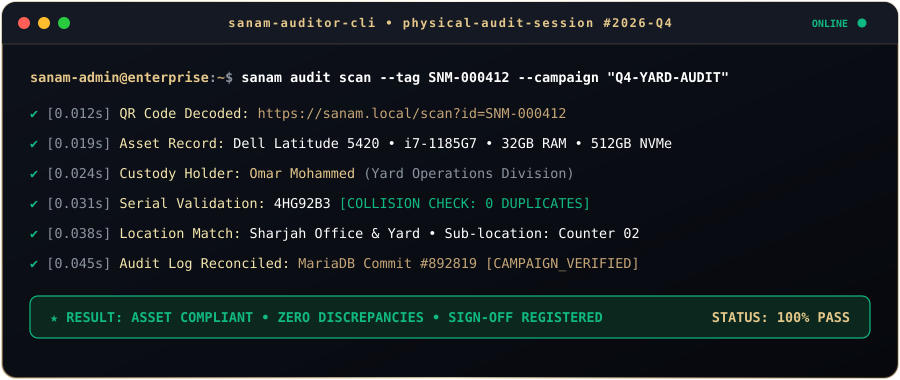
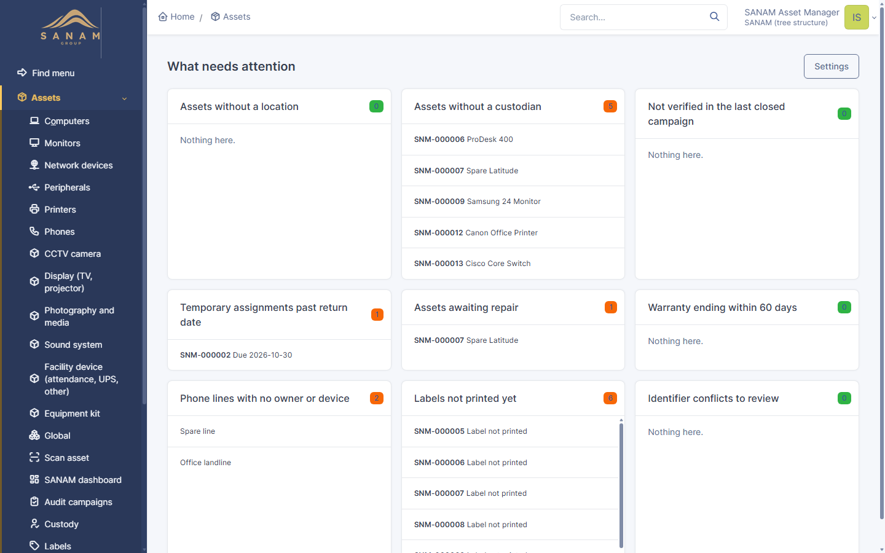
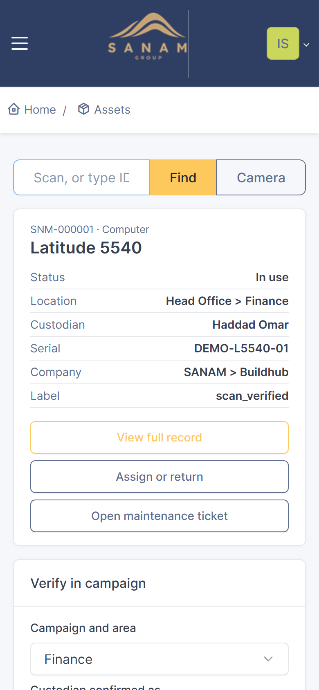
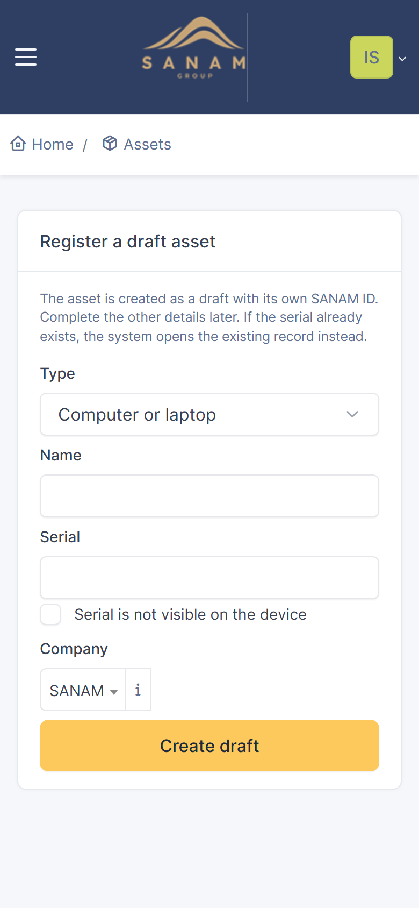
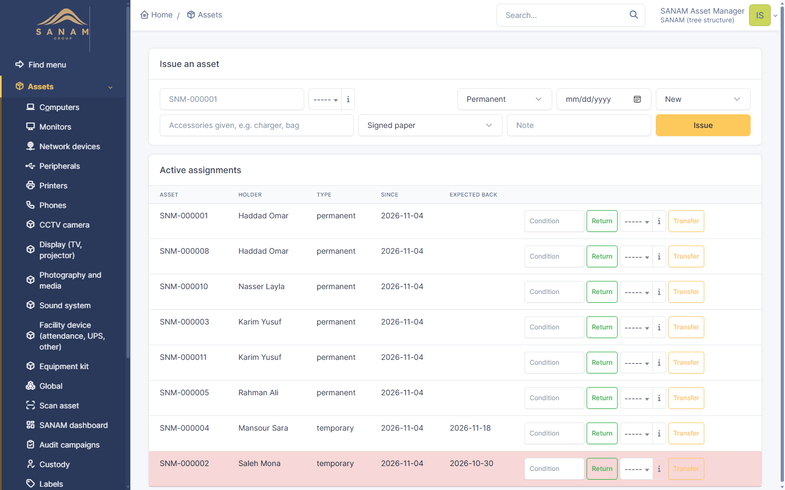
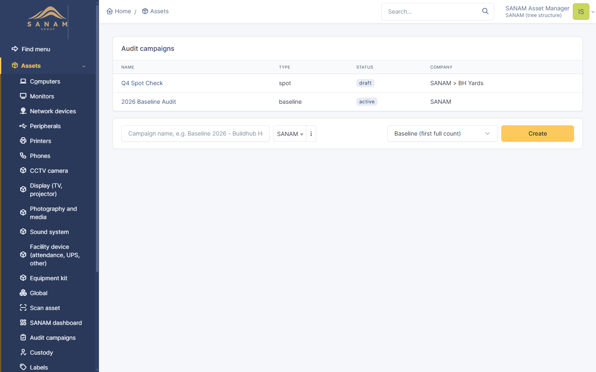
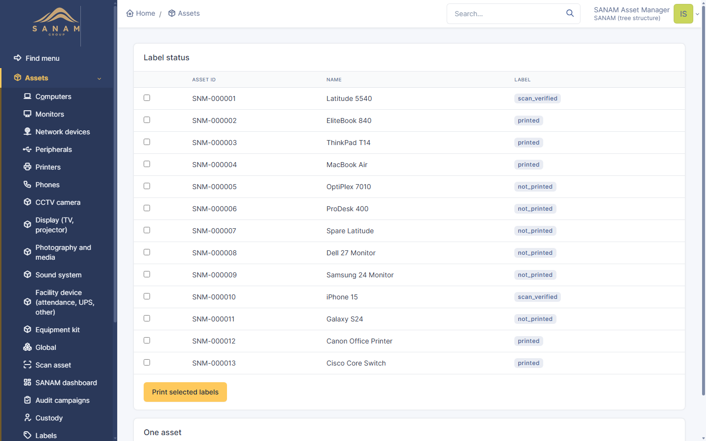
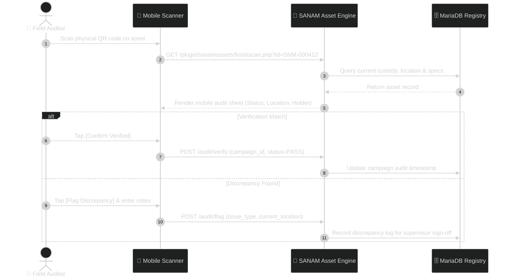

<div align="center">

<!-- Hero Banner (Custom Luxury Vector SVG) -->
<a href="https://github.com/it1buildhub-hue/SANAM">
  
</a>

<br/><br/>

<!-- Animated Luxury Typing Subtitle -->
<a href="https://github.com/it1buildhub-hue/SANAM">
  
</a>

<br/>

<!-- Curated Metallic Gold & Obsidian Badges -->
<p align="center">
  
  
  
  
  
  
</p>

<!-- Interactive Luxury Navigation -->
<p align="center">
  <a href="#-overview"><b>✦ OVERVIEW</b></a> &nbsp;•&nbsp;
  <a href="#-core-pillars-bento-grid"><b>✦ BENTO PILLARS</b></a> &nbsp;•&nbsp;
  <a href="#-live-auditor-terminal-simulation"><b>✦ LIVE SCAN TERMINAL</b></a> &nbsp;•&nbsp;
  <a href="#-visual-walkthrough"><b>✦ VISUAL TOUR</b></a> &nbsp;•&nbsp;
  <a href="#-workflow-architecture"><b>✦ ARCHITECTURE</b></a> &nbsp;•&nbsp;
  <a href="#-instant-deployment"><b>✦ QUICKSTART</b></a>
</p>


</div>

---

## 💎 Overview

**SANAM** is an enterprise IT Asset Management and ITIL Service Desk platform engineered for organizations that cannot afford inventory discrepancies. Traditional asset tools suffer from duplicate serials, forgotten custody changes, and clunky barcode apps that auditors refuse to use in the field.

SANAM eradicates these points of failure through a **luxury-tier design system**, an **immutable sequential ID engine**, a **zero-install mobile QR audit workflow**, and **full employee custody lifecycle verification**.

```
  ┌──────────────────────────────────────────────────────────────────────────────────┐
  │                           THE SANAM LIFECYCLE PARADIGM                           │
  └──────────────────────────────────────────────────────────────────────────────────┘
    [ Receiving Dock ]  ───►  [ Permanent SNM-000001 ]  ───►  [ QR Code Labeling ]
                                                                      │
    [ Exit Sign-Off ]   ◄───  [ Mobile Field Audit ]    ◄─────────────┘
```

---

## 🍱 Core Pillars (Bento Grid)

<table align="center" width="100%" border="0" cellSpacing="10" cellPadding="0">
  <tr>
    <td width="55%" valign="top" style="padding: 20px; background: linear-gradient(145deg, #0e131f, #07090e); border: 1px solid rgba(196,164,119,0.45); border-radius: 12px; box-shadow: 0 4px 20px rgba(0,0,0,0.5);">
      <h3 style="color: #D4AF37; margin-top: 0;">📱 Mobile QR Field Audit Engine</h3>
      <p style="color: #F3E5AB; font-size: 14px; line-height: 1.6;">
        Transform any smartphone into an enterprise barcode auditor without installing third-party apps or MDM profiles. Auditors point their camera, inspect registered custody, and verify physical state in milliseconds.
      </p>
      <ul style="color: #E5C78A; font-size: 13.5px; line-height: 1.8;">
        <li><b>Single-Tap Verification:</b> Real-time matching against MariaDB registry.</li>
        <li><b>Instant Discrepancy Flagging:</b> Mark damaged, relocated, or unaccounted devices.</li>
        <li><b>Dockside Drafting:</b> Register inbound hardware straight from the loading bay.</li>
      </ul>
    </td>
    <td width="45%" valign="top" style="padding: 20px; background: linear-gradient(145deg, #0e131f, #07090e); border: 1px solid rgba(196,164,119,0.45); border-radius: 12px; box-shadow: 0 4px 20px rgba(0,0,0,0.5);">
      <h3 style="color: #D4AF37; margin-top: 0;">🔒 Immutable Asset Identity</h3>
      <p style="color: #F3E5AB; font-size: 14px; line-height: 1.6;">
        Hardware changes hands, parts get swapped, but identity remains permanent.
      </p>
      <ul style="color: #E5C78A; font-size: 13.5px; line-height: 1.8;">
        <li><b>Sequential IDs:</b> Permanent <code>SNM-000001</code> format; never reused.</li>
        <li><b>Zero-Tolerance Collision Check:</b> Blocks duplicate serial registrations.</li>
        <li><b>Tamper-Proof History:</b> Survives company re-allocations and entity transfers.</li>
      </ul>
    </td>
  </tr>
  <tr>
    <td width="45%" valign="top" style="padding: 20px; background: linear-gradient(145deg, #0e131f, #07090e); border: 1px solid rgba(196,164,119,0.45); border-radius: 12px; box-shadow: 0 4px 20px rgba(0,0,0,0.5);">
      <h3 style="color: #D4AF37; margin-top: 0;">🏢 Multi-Entity &amp; Telecom Tracking</h3>
      <p style="color: #F3E5AB; font-size: 14px; line-height: 1.6;">
        Manage enterprise subsidiaries, operating yards, and cellular line allocations together.
      </p>
      <ul style="color: #E5C78A; font-size: 13.5px; line-height: 1.8;">
        <li><b>SIM &amp; Number Management:</b> Etisalat/carrier line assignments tied to hardware.</li>
        <li><b>Custody Trails:</b> Employee issue forms, transfer receipts, and exit clearances.</li>
        <li><b>Micro-Location Pinpoint:</b> Track down to specific yard buildings and office counters.</li>
      </ul>
    </td>
    <td width="55%" valign="top" style="padding: 20px; background: linear-gradient(145deg, #0e131f, #07090e); border: 1px solid rgba(196,164,119,0.45); border-radius: 12px; box-shadow: 0 4px 20px rgba(0,0,0,0.5);">
      <h3 style="color: #D4AF37; margin-top: 0;">⚡ Frictionless Local Deployment</h3>
      <p style="color: #F3E5AB; font-size: 14px; line-height: 1.6;">
        Eliminate weeks of setup complexity. Provision full instances with PowerShell automation.
      </p>
      <ul style="color: #E5C78A; font-size: 13.5px; line-height: 1.8;">
        <li><b>One-Command Provisioning:</b> Automatic schema compilation and table seeding.</li>
        <li><b>Parallel Sandboxes:</b> Instant demo environments on isolated ports.</li>
        <li><b>Zero Overhead:</b> Built-in PHP server binding for rapid internal audits.</li>
      </ul>
    </td>
  </tr>
</table>

---

## ⚡ Live Auditor Terminal Simulation

Experience how field auditors interact with SANAM's low-latency command engine:

<div align="center">
  
</div>

---

## 📸 Visual Walkthrough

### 🖥️ Executive Command Center
Unified oversight over operational readiness, verification campaign progress, and hardware depreciation:
<div align="center">
  
</div>

<br/>

### 📱 Zero-App Mobile Operations

| 1. Instant QR Identification | 2. Dockside Hardware Registration | 3. Custody &amp; Handover Sign-Off |
|:---:|:---:|:---:|
|  |  |  |
| *Real-time QR barcode decode & status lookup* | *Direct auditor registration for new arrivals* | *Asset assignment, transfer & return clearance* |

<br/>

### 🗂️ Audit Verification Campaigns &amp; High-Density Labels

| Structured Verification Campaigns | Print-Ready QR Asset Labels |
|:---:|:---:|
|  |  |
| *Multi-area tracking with real-time pass/fail indicators* | *High-contrast QR tags with permanent SNM identifiers* |

---

## 🔄 Workflow Architecture



---

## ⚖️ SANAM vs Generic Systems

| Feature | Generic Inventory Software | SANAM Enterprise Platform |
|---|:---:|:---:|
| **Identity Standard** | Mutable asset names & loose serials | 🔒 **Permanent, immutable sequential IDs (`SNM-xxxxxx`)** |
| **Field Verification** | Paper checklists or heavy 3rd-party apps | 📱 **Zero-install mobile web scanner with discrepancy logging** |
| **Serial Collision** | Rarely checked; silent duplicates occur | 🛡️ **Zero-tolerance duplicate serial validation on commit** |
| **Custody Lifecycle** | Simple dropdown assignment | 📋 **Full issue, return, transfer, and exit sign-off receipts** |
| **Telecom Integration** | Unconnected spreadsheets | 📞 **Native corporate SIM, number, and device pairing** |
| **Theme & Aesthetic** | Dated generic utility styling | 💎 **Luxury Obsidian & Royal Gold executive design** |
| **Deployment Time** | Days of manual DB & dependency work | ⚡ **Single-command PowerShell automation (`install.ps1`)** |

---

## 🚀 Instant Deployment

### 📋 Prerequisites
- **Windows 10 / 11 / Server** (or Linux with PHP CLI)
- **PHP 8.3+** with extensions: `curl`, `gd`, `intl`, `mysqli`, `openssl`, `mbstring`
- **MariaDB 10.6+ / 11.x** running locally on port `3306`

### 1️⃣ Clone the Repository
```powershell
git clone https://github.com/it1buildhub-hue/SANAM.git
cd SANAM
```

### 2️⃣ Automated Installation
Run the automated installation script. It builds the schema, configures paths, and seeds default parameters:

```powershell
powershell -NoProfile -ExecutionPolicy Bypass -File scripts\install.ps1
```

> **Need a Sandbox?** Build an isolated demonstration instance with sample data on port `8083`:
> ```powershell
> powershell -NoProfile -ExecutionPolicy Bypass -File scripts\install.ps1 -Demo
> ```

### 3️⃣ Start the Service
```powershell
powershell -NoProfile -ExecutionPolicy Bypass -File scripts\start.ps1
```

Open your browser to:
👉 **`http://127.0.0.1:8081`** *(or `http://127.0.0.1:8083` for Demo)*

---

## 🛠️ Automation & Administration

The [`plugin/sanamassets/tools/`](file:///C:/Users/buildhub/IT-assets/plugin/sanamassets/tools/) directory provides robust administrative utilities:

| Tool | Purpose | Command |
|---|---|---|
| `seed_sanam.php` | Idempotent baseline seeder: asset types, states, roles | `php tools/seed_sanam.php` |
| `seed_fields.php` | Extra telemetry fields: IMEI2, PoE, management IP | `php tools/seed_fields.php` |
| `seed_demo.php` | Sample corporate hardware, phone lines, and custody records | `php tools/seed_demo.php` |
| `backup_restore_test.ps1` | Automated backup dump, restore rehearsal, and table checksum verification | `powershell -File tools/backup_restore_test.ps1` |

<details>
<summary><b>🔍 Directory Tree Details</b></summary>

```
SANAM/
├── core/                        # SANAM 11 application core
│   ├── ajax/                    # Asynchronous endpoints
│   ├── bin/                     # CLI console utilities
│   ├── inc/                     # Core system definitions
│   ├── src/Sanam/               # SANAM core namespace & classes
│   └── templates/               # Twig layout templates
├── plugin/
│   └── sanamassets/             # SANAM Assets Custom Extension
│       ├── front/               # Scan, campaign, label, custody interfaces
│       ├── src/                 # AssetId, Campaign, Custody, Label, Scan engines
│       ├── theme/               # Luxury Obsidian & Royal Gold SCSS styling
│       └── tools/               # Seeding, backup rehearsals & provisioning
├── scripts/
│   ├── install.ps1              # Deployment & database installer
│   └── start.ps1                # Background service launcher
└── docs/
    └── images/                  # High-resolution vector assets & UI screenshots
```
</details>

---

<div align="center">


### 👑 SANAM — Crafted for Uncompromised Operational Excellence
Distributed under the **GNU General Public License (GPLv3)**.

</div>
