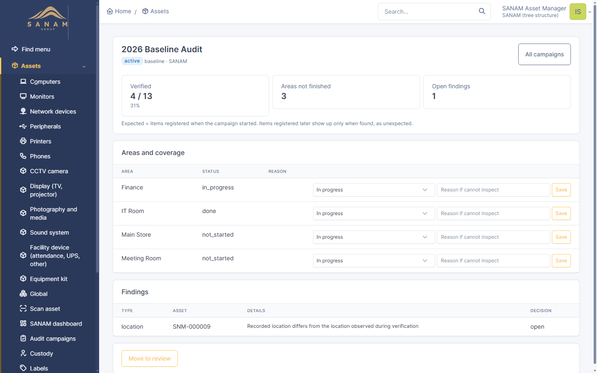
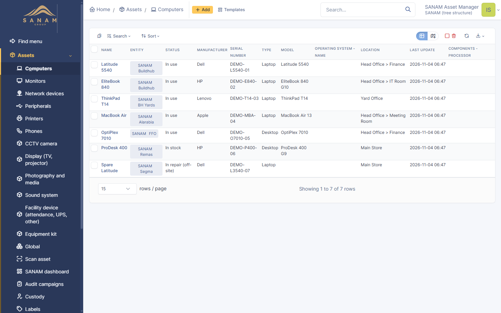

# SANAM — IT Asset Management System

SANAM is an IT Asset Management and ITIL Service Desk platform designed for complete physical asset tracking, lifecycle management, and audit verification.

---

## 📸 Overview & Features

### Actionable Asset Dashboard
Real-time visibility into asset distribution, pending audits, warranty lifecycles, and operational readiness.


### Key Capabilities

| Feature | Description |
|---|---|
| **Permanent Asset Identification** | Sequential, unique, permanent asset IDs (`SNM-000001`...) with duplicate prevention |
| **QR Code Asset Labels** | Instant label generation and printing with direct mobile lookup |
| **Mobile & Auditor Scanner** | Responsive mobile interface for scanning QR tags and rapid custody verification |
| **Audit Campaigns** | Periodic verification cycles, area tracking, discrepancy analysis, review and sign-off |
| **Custody & Handover** | Issue, return, employee transfer workflows with clear custody logs |
| **Company & Telecom Lines** | Native tracking of corporate subscriptions, SIMs, and hardware assignments |

---

## 📱 Mobile & Audit Interface

| Scanner | Registration | Custody & Handover |
|:---:|:---:|:---:|
|  |  |  |

---

## 🗂️ Audit Campaigns & Reporting

Track and verify physical equipment across departments, locations, and subsidiaries with discrepancy detection:




---

## 🏷️ Asset Labels & Hardware Management

Generate print-ready QR labels and view unified inventory records:




---

## 🚀 Quick Start (Windows)

### Prerequisites
- **PHP 8.3+** with required extensions (`curl`, `gd`, `intl`, `mysqli`, `openssl`, `mbstring`)
- **MariaDB 10.6+ / 11.x** running on local port `3306`

### Installation
Run the automated installation script:

```powershell
powershell -NoProfile -ExecutionPolicy Bypass -File scripts\install.ps1
```

For a separate demonstration instance with sample data:
```powershell
powershell -NoProfile -ExecutionPolicy Bypass -File scripts\install.ps1 -Demo
```

### Running the Server
To start the local SANAM service:

```powershell
powershell -NoProfile -ExecutionPolicy Bypass -File scripts\start.ps1
```

The service will start at `http://127.0.0.1:8081` (or `8083` for Demo).

---

## 📁 Repository Structure

```
├── core/               # Rebranded SANAM 11 application core
├── plugin/             # Custom extension plugins
│   └── sanamassets/    # Core SANAM Assets plugin (IDs, QR, audits, custody)
├── scripts/            # PowerShell deployment and lifecycle automation
│   ├── install.ps1     # Database seeding and configuration setup
│   └── start.ps1       # Service launcher
└── docs/               # Visual documentation and screenshots
    └── images/
```

---

## 📄 License
SANAM is distributed under the GNU General Public License (GPLv3).
