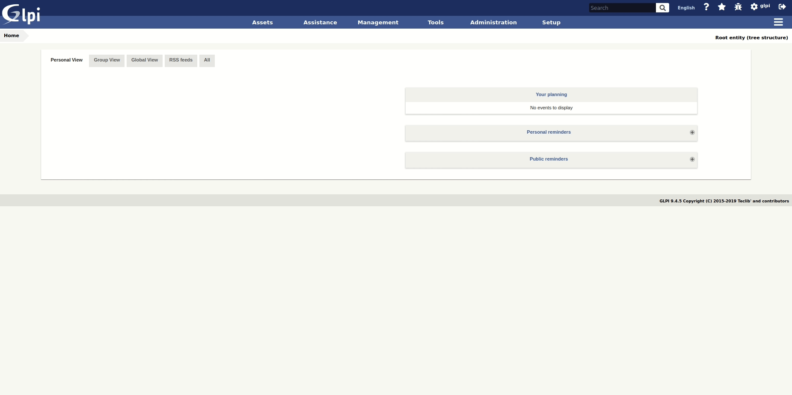

# Datainjection SANAM plugin

This plugin allows data import into [SANAM](#) using CSV files.

It allows to create models of injection for a future re-use. It's been created in order to:

- import data coming from others asset management softwares
- inject electronic delivery forms

Data to be imported using the plugins are:

- inventory data (except softwares and licenses),
- management data (contract, contact, supplier),
- configuration data (user, group, entity).

## Documentation

We maintain a detailed documentation here -> [Documentation](#)

## Contact

For notices about major changes and general discussion of datainjection, subscribe to the [/r/sanam](#) subreddit.
You can also chat with us via IRC in [#sanam on freenode](#) or [@sanam on Telegram](#).

## Professional Services

The SANAM Network services are available through our [Partner's Network](http://www.teclib-edition.com/en/partners/). We provide special training, bug fixes with editor subscription, contributions for new features, and more.

Obtain a personalized service experience, associated with benefits and opportunities.

## Contributing

* Open a ticket for each bug/feature so it can be discussed
* Follow [development guidelines](#)
* Refer to [GitFlow](http://git-flow.readthedocs.io/) process for branching
* Work on a new branch on your own fork
* Open a PR that will be reviewed by a developer

## Copying

* **Code**: you can redistribute it and/or modify
    it under the terms of the GNU General Public License ([GPL-2.0](https://www.gnu.org/licenses/gpl-2.0.en.html)).
